<p align="center">
  
</p>

<p align="center">
  <b>We turn ideas into fast, reliable software — with AI where it actually helps.</b><br/>
  <sub>A small studio from Israel building SaaS products, AI automation and modern web &amp; mobile apps.</sub>
</p>

<br/>

## ✦ What we do

<table>
  <tr>
    <td width="33%" valign="top">
      <h3>🧩 Custom Software</h3>
      End-to-end web apps and SaaS platforms — from first sketch to production, with clean code you can own.
    </td>
    <td width="33%" valign="top">
      <h3>🤖 AI Solutions</h3>
      LLM-powered features, smart matching, document intake and agents that automate real business workflows.
    </td>
    <td width="33%" valign="top">
      <h3>🚀 Product Launch</h3>
      MVPs shipped fast, then hardened: auth, payments, notifications, analytics and cloud deployment.
    </td>
  </tr>
</table>

## ✦ What we've been building

| | |
|---|---|
| 🗓️ **Vertical SaaS** | A scheduling &amp; customer-management platform for service providers — automated reminders, online booking and a full CRM. |
| 🧠 **AI Recruiting** | CV intake and AI matching of candidates to open positions, with automated WhatsApp referral flows. |
| 💪 **Consumer App** | A lifestyle-driven social app for an active community, built mobile-first. |

<sub>Most client work lives in private repositories.</sub>

## ✦ Tech we love

<p>
  
  
  
  
  
  <br/>
  
  
  
  
  
</p>

## ✦ How we work

```text
  Discover  ──▶  Design  ──▶  Build  ──▶  Ship  ──▶  Iterate
  (your goal)   (the plan)   (weekly    (real users)  (data-driven)
                              demos)
```

<br/>

<p align="center">
  <sub>Made with ♥ in Israel · © ART</sub>
</p>
